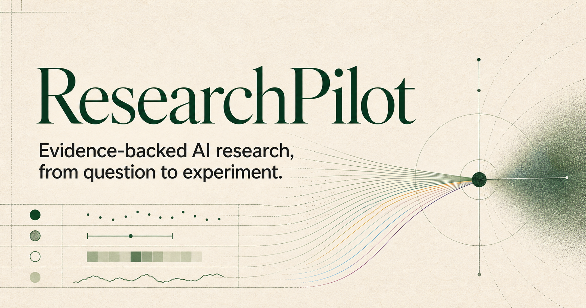
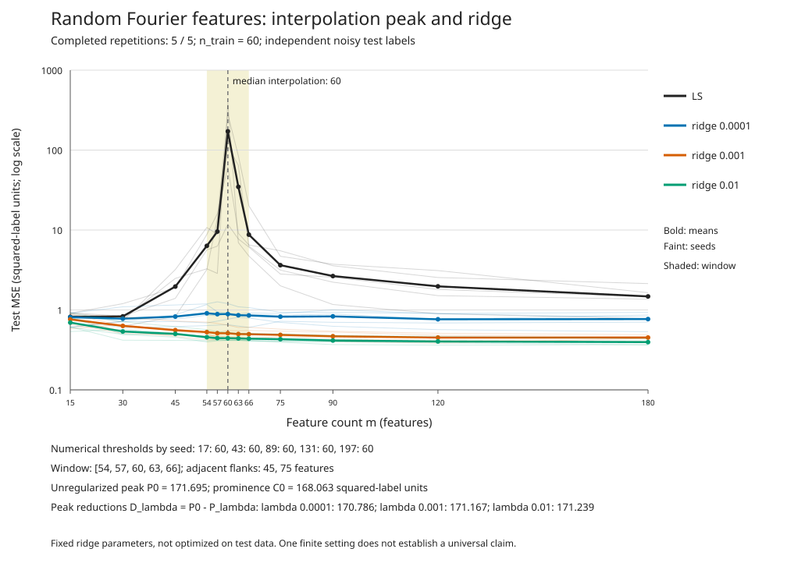
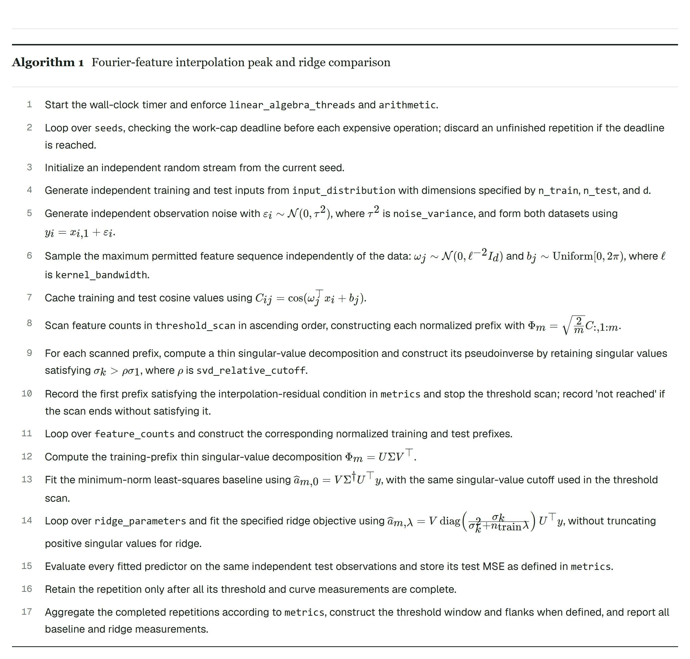
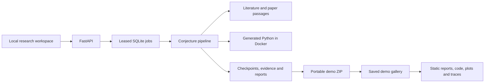

# ResearchPilot

**An inspectable research assistant for mathematical and machine learning conjectures.** ResearchPilot connects literature review, paper reading, controlled experiments, and evidence synthesis. Reports link claims to source passages and recorded measurements, and explain when the evidence is insufficient.



## Explore the demos

Browse the [demo gallery](https://research-pilot-psi.vercel.app/) to inspect three saved investigations, including their conjectures, sources, generated Python, plots, reports, and traces. The gallery is read-only and requires no installation, backend, or API key.

| Demo | Conjecture being tested | Saved report |
| --- | --- | --- |
| [Double descent](https://research-pilot-psi.vercel.app/?demo=double-descent) | Increasing random Fourier features produces an interpolation peak in noisy regression, and ridge regularization reduces that peak. | [Report](frontend/public/demos/double-descent/report.pdf) |
| [Spurious correlations](https://research-pilot-psi.vercel.app/?demo=spurious-correlations) | A predictive shortcut improves in-distribution accuracy but harms generalization when its correlation reverses. | [Report](frontend/public/demos/spurious-correlations/report.pdf) |
| [Overfitting under label noise](https://research-pilot-psi.vercel.app/?demo=overfitting-noise) | Increasing training-set size narrows the gap between noisy-label training accuracy and clean test accuracy. | [Report](frontend/public/demos/overfitting-noise/report.pdf) |

These are recorded investigations, including their limitations and inconclusive outcomes.

The two pictures below are screenshots of the Experiments tab from the double descent demo.


*Experimental results for the double descent demo.*



*Pseudocode for the double descent demo.*

## How investigations work

Enter a precisely scoped true/false conjecture and optionally attach papers before starting. The pipeline:

1. Interprets the statement and its assumptions.
2. Reasons about the conjecture, searches for corroborating sources, and retrieves additional scholarly literature.
3. Reviews paper passages and separates support, contradiction, qualifications, and related context.
4. Designs a finite numerical test, generates Python and visualization code, and executes it when Docker is configured.
5. Synthesizes the recorded evidence into a qualitative assessment and an inspectable report.

Missing papers, invalid model responses, code-generation failures, and execution failures remain visible in the trace. An attached paper can define a method without supplying evidence for the conjecture. Numerical experiments establish results in the tested setting; they do not prove universal mathematical claims.



The workflow lives in [conjecture_pipeline.py](researchpilot/conjecture_pipeline.py). See the [workflow guide](docs/CONJECTURE_WORKFLOW.md) for stage contracts and the [security model](docs/SECURITY.md) for execution boundaries.

## Local setup

To browse the gallery locally or run your own investigations, follow the [local setup guide](frontend/public/demos/local-setup.md). It covers installation, Docker preparation, API keys, deployment modes, and starting the backend and frontend.

## Save and publish a demo

Runs persist locally in `.researchpilot/`, which is ignored by Git. To preserve a result, use **Report → Save demo ZIP**, or:

```powershell
python -m researchpilot.cli list
python -m researchpilot.cli export-demo RESEARCH_ID --output demos/my-investigation.zip
python -m researchpilot.cli publish-demo demos/my-investigation.zip --slug my-investigation --title "My investigation" --summary "The conjecture and comparison being tested."
```

Demo export includes a typeset `report.pdf` and requires XeLaTeX with the TeX Gyre fonts on the backend host. Review the ZIP before publishing.

`publish-demo` verifies the manifest, typesets older snapshots that lack a PDF, and prepares gallery files under `frontend/public/demos/`. It does not deploy the website. Commit the curated ZIPs and prepared gallery assets; Vercel serves the saved PDFs without a backend or LaTeX installation.

Existing ZIP filenames and gallery slugs are protected from overwriting by default. Use `publish-demo --replace` to refresh an existing gallery entry. See the [demo guide](demos/README.md) for the snapshot format and workflow.

For Vercel, select `frontend` as the project root, use the Next.js preset, and set `NEXT_PUBLIC_RESEARCHPILOT_DEMO_ONLY=true` before building. Set `NEXT_PUBLIC_SITE_URL` to the public site URL. The curated gallery works without a deployed backend.

## Verification

Install test dependencies and run the offline suite:

```powershell
python -m pip install -e ".[api,literature,math,dev,identity,telemetry]"
python -m unittest discover -s tests -q
cd frontend
npm test
npm run lint
npm run typecheck
npm run build
```

Tests cover grounding, provider routing, paper ingestion, persistence, API/job behavior, generated experiment handling, portable exports, and frontend presentation. Docker runtime checks require explicit opt-in. The standalone `tests/test_katex_provider.py` tool makes a paid model request only when explicitly run in live mode; ordinary test discovery does not call it.